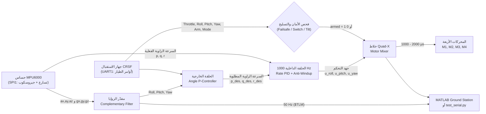
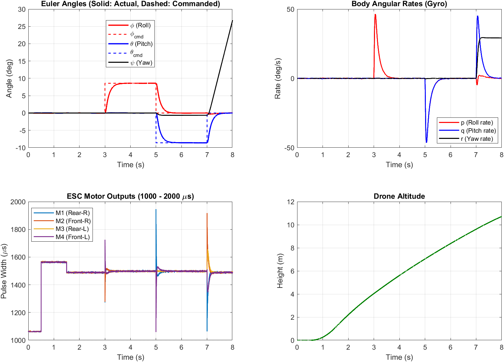

# الدليل الشامل والمفصّل تفصيلاً دقيقاً لمشروع الدرون (MAMBA F405 MK2 V2 + MATLAB + Embedded C)

> [!NOTE]
> هذا الملف هو المرجع الكامل والشامل لكل ملف، دالة، متغير، ثابت، سجل (Register)، معادلة رياضية، وطرف توصيل (Pin) داخل هذا المشروع، بحيث تفهم **بالضبط ماذا يفعل كل سطر** ولماذا كُتب بهذه الطريقة.

---

## جدول المحتويات

1. [الفكرة العامة للمشروع وهندسة النظام](#1-الفكرة-العامة-للمشروع-وهندسة-النظام)
2. [خريطة كل ملفات ومجلدات المشروع](#2-خريطة-كل-ملفات-ومجلدات-المشروع)
3. [تفاصيل الهاردوير لبطاقة MAMBA F405 MK2 V2 (`docs/mamba_f405_pinout.md`)](#3-تفاصيل-الهاردوير-لبطاقة-mamba-f405-mk2-v2)
4. [النموذج الرياضي والفيزيائي للدرون (`docs/quadcopter_dynamics.md`)](#4-النموذج-الرياضي-والفيزيائي-للدرون)
5. [الشرح المفصل لملفات MATLAB ملفاً بملف](#5-الشرح-المفصل-لملفات-matlab-ملفاً-بملف)
   - [5.1 `matlab/init_drone_parameters.m`](#51-matlabinit_drone_parametersm)
   - [5.2 `matlab/attitude_estimator.m`](#52-matlabattitude_estimatorm)
   - [5.3 `matlab/flight_controller.m`](#53-matlabflight_controllerm)
   - [5.4 `matlab/drone_simulation.m`](#54-matlabdrone_simulationm)
   - [5.5 `matlab/generate_c_code.m`](#55-matlabgenerate_c_codem)
   - [5.6 `matlab/telemetry_ground_station.m`](#56-matlabtelemetry_ground_stationm)
6. [الشرح المفصل لملفات الفيرموير بلغة C (`firmware/`)](#6-الشرح-المفصل-لملفات-الفيرموير-بلغة-c)
   - [6.1 `firmware/inc/config.h`](#61-firmwareincconfigh)
   - [6.2 `firmware/inc/mpu6000.h` و `firmware/src/mpu6000.c`](#62-firmwareincmpu6000h-و-firmwaresrcmpu6000c)
   - [6.3 `firmware/inc/motors.h` و `firmware/src/motors.c`](#63-firmwareincmotorsh-و-firmwaresrcmotorsc)
   - [6.4 `firmware/inc/rc_receiver.h` و `firmware/src/rc_receiver.c`](#64-firmwareincrc_receiverh-و-firmwaresrcrc_receiverc)
   - [6.5 `firmware/inc/flight_controller.h` و `firmware/src/flight_controller.c`](#65-firmwareincflight_controllerh-و-firmwaresrcflight_controllerc)
   - [6.6 `firmware/inc/telemetry.h` و `firmware/src/telemetry.c`](#66-firmwareinctelemetryh-و-firmwaresrctelemetryc)
   - [6.7 `firmware/src/main.c`](#67-firmwaresrcmainc)
   - [6.8 `firmware/CMakeLists.txt`](#68-firmwarecmakeliststxt)
7. [الأدوات المساعدة وملفات Git (`tools/test_serial.py` و `.gitignore`)](#7-الأدوات-المساعدة-وملفات-git)
8. [دورة حياة العمل الكاملة (من المحاكاة إلى الطيران الفعلي) وما يلزم لربط STM32 HAL](#8-دورة-حياة-العمل-الكاملة-وما-يلزم-لربط-stm32-hal)

---

## 1. الفكرة العامة للمشروع وهندسة النظام

يعتمد هذا المشروع على منهجية **Model-Based Design (التصميم القائم على النماذج)** لبرمجة طائرة رباعية المراوح (Quadcopter) بتكوين **Quad-X** باستخدام بطاقة التحكم **Diatone MAMBA F405 MK2 V2** المبنية على المعالج **STM32F405RGT6**.

ينقسم المشروع إلى مسارين متطابقين رياضياً:
1. **بيئة المحاكاة والتصميم في MATLAB (`matlab/`)**:
   - تحاكي فيزياء الدرون الكاملة بست درجات حرية (**6-DOF**: حركة خطية $x, y, z$ ودوران $\phi, \theta, \psi$).
   - تختبر خوارزمية تقدير الزوايا (Complementary Filter) ومتحكم الـ **Cascaded PID** ومصفوفة خلط المحركات قبل لمس الهاردوير الحقيقي.
   - توفر أداة لتوليد كود C عبر MATLAB Coder، وأداة محطة أرضية (Ground Station) لرسم قراءات الدرون الحقيقية لحظياً عبر منفذ USB/UART.
2. **بيئة الفيرموير المدمج بلغة C (`firmware/`)**:
   - تنفذ نفس الخوارزميات الرياضية الموجودة في MATLAB لكن بلغة C سريعة وموجهة للمعالج **ARM Cortex-M4** بتردد حلقة تحكم حتمي **1000 هرتز (كل 1 ملي ثانية)**.
   - تدير قراءة حساس الجيروسكوب والتسارع **MPU6000** عبر ناقل **SPI1**، وفك تشفير إشارات جهاز التحكم **CRSF (ExpressLRS / Crossfire)** عبر **UART1**، وتوليد نبضات **PWM** للمحركات الأربعة، وإرسال بيانات المراقبة **Telemetry** إلى MATLAB عبر **UART6**.



---

## 2. خريطة كل ملفات ومجلدات المشروع

| المسار | النوع | الوظيفة الأساسية |
| :--- | :--- | :--- |
| `README.md` | توثيق | الدليل السريع للمشروع، الهيكل العام، وطرق التشغيل والحرق. |
| `FULL_PROJECT_GUIDE_AR.md` | توثيق | هذا الملف: الشرح الموسّع والمفصل لكل جزء في المشروع. |
| `.gitignore` | Git | قائمة الملفات المؤقتة وملفات البناء التي لا يجب رفعها في Git. |
| `docs/mamba_f405_pinout.md` | مرجع هاردوير | خريطة الأرجل (Pinout)، النواقل (SPI/UART/ADC)، وأطراف التصحيح SWD. |
| `docs/quadcopter_dynamics.md` | مرجع رياضي | معادلات نيوتن-أويلر، مصفوفة الدوران، مصفوفة الخلط، ونظرية Cascaded PID. |
| `matlab/init_drone_parameters.m` | MATLAB | تعريف الثوابت الفيزيائية للدرون، حدود الـ PWM، وقيم الـ PID والفلتر. |
| `matlab/attitude_estimator.m` | MATLAB Function | دالة تقدير الزوايا ($\phi, \theta, \psi$) بدمج التسارع والجيروسكوب (قابلة لتوليد C). |
| `matlab/flight_controller.m` | MATLAB Function | دالة التحكم الرئيسية: تقدير الزاوية + الحلقة الخارجية + الحلقة الداخلية + الخلط. |
| `matlab/drone_simulation.m` | MATLAB Script | محاكاة كاملة لمدة 8 ثوانٍ (8001 خطوة) لـ 6 درجات حرية مع رسم 4 منحنيات. |
| `matlab/generate_c_code.m` | MATLAB Script | أتمتة تحويل `flight_controller.m` إلى لغة C عبر `codegen`. |
| `matlab/telemetry_ground_station.m` | MATLAB Script | محطة أرضية حية تقرأ المنفذ التسلسلي وترسم الزوايا والمحركات بالوقت الحقيقي. |
| `firmware/CMakeLists.txt` | CMake | إعدادات المترجم `arm-none-eabi-gcc` لمعالج Cortex-M4 وتوليد `.elf/.bin/.hex`. |
| `firmware/inc/config.h` | C Header | الترددات، حدود الأمان، وتعريفات الأرجل والمنافذ الخاصة بـ Mamba F405. |
| `firmware/inc/mpu6000.h` | C Header | عناوين سجلات حساس MPU6000، معاملات التحويل الفيزيائية، وبنية `MPU6000_Data_t`. |
| `firmware/src/mpu6000.c` | C Source | تهيئة MPU6000 عبر SPI، معايرة الجيروسكوب، والقراءة السريعة لـ 14 بايت دفعة واحدة. |
| `firmware/inc/motors.h` | C Header | بنية مخارج المحركات الأربعة `Motor_Outputs_t` وواجهات التشغيل/الإيقاف. |
| `firmware/src/motors.c` | C Source | حصر قيم الـ PWM بين 1000 و 2000 µs وإرسالها لقنوات المؤقتات. |
| `firmware/inc/rc_receiver.h` | C Header | بنية قنوات الريموت `RC_Channels_t` وواجهات فك التشفير وفحص انقطاع الإشارة. |
| `firmware/src/rc_receiver.c` | C Source | فك تشفير إطارات بروتوكول CRSF (11-bit packed) وحماية Failsafe. |
| `firmware/inc/flight_controller.h` | C Header | بنية الزوايا `Attitude_t` وبنية المعاملات `PID_Gains_t` ودوال التحكم. |
| `firmware/src/flight_controller.c` | C Source | التنفيذ المدمج بلغة C للفلتر التكميلي ومتحكم Cascaded PID وخلاط Quad-X. |
| `firmware/inc/telemetry.h` | C Header | واجهات بث حزم التليميتري. |
| `firmware/src/telemetry.c` | C Source | تنسيق السطر النصي `$TLM,...` وإرساله عبر UART6. |
| `firmware/src/main.c` | C Source | نقطة الدخول، مقاطعة 1 ms (`SysTick_Handler`)، منطق التسليح، والحلقة الحتمية 1 kHz. |
| `tools/test_serial.py` | Python | أداة سطر أوامر خفيفة لاختبار استقبال حزم `$TLM` من USB بدون فتح MATLAB. |

---

## 3. تفاصيل الهاردوير لبطاقة MAMBA F405 MK2 V2

الملف المرجعي: [`docs/mamba_f405_pinout.md`](docs/mamba_f405_pinout.md)

### 3.1 المعالج الرئيسي (MCU)
* **الموديل**: `STM32F405RGT6` من عائلة ARM Cortex-M4 مع وحدة حساب الفاصلة العائمة (**FPU** - Floating Point Unit) مما يجعل حسابات `float` في الفلتر والـ PID فائقة السرعة.
* **سرعة الساعة (Clock)**: `168 MHz`.
* **ذاكرة البرنامج (Flash)**: `1024 KB` (1 ميجابايت).
* **الذاكرة العشوائية (SRAM)**: `192 KB` (مقسمة إلى `128 KB` SRAM قياسية + `64 KB` CCM RAM فائقة السرعة مرتبطة بالمعالج مباشرة).
* **جهد المنطق الداخلي**: `3.3V` (بينما تتغذى البطاقة خارجياً من `5V` أو جهد البطارية `V_BAT`).

### 3.2 الحساسات والذواكر الداخلية على البطاقة (نواقل SPI)
1. **حساس الحركة IMU (`MPU6000` أو `BMI270` في بعض الإصدارات الحديثة) على الناقل `SPI1`**:
   * `PA5` (`SPI1_SCK`): نبضة الساعة المتزامنة بين المعالج والحساس.
   * `PA6` (`SPI1_MISO`): خط البيانات القادم من الحساس إلى المعالج.
   * `PA7` (`SPI1_MOSI`): خط الأوامر المرسل من المعالج إلى الحساس.
   * `PC2` (`CS` - Chip Select): عند خفضه إلى `0` (Active LOW) يبدأ التخاطب مع الـ IMU، وعند رفعه إلى `1` ينتهي.
   * `PC4` (`INT`): إشارة مقاطعة (Rising Edge) تنبّه المعالج عندما تصبح قراءة جديدة جاهزة.
2. **شريحة العرض على الفيديو OSD (`AT7456E`) على الناقل `SPI2`**:
   * `PB13` (`SCK`)، `PB14` (`MISO`)، `PB15` (`MOSI`)، `PB12` (`CS`). تستخدم إذا كنت ستضيف كاميرا FPV ونظارة لطباعة البيانات فوق الصورة.
3. **ذاكرة الصندوق الأسود (`W25Q128` بحجم 16MB NOR Flash) على الناقل `SPI3`**:
   * `PC10` (`SCK`)، `PC11` (`MISO`)، `PC12` (`MOSI`)، `PC13` (`CS`). تستخدم لتسجيل بيانات الطيران عالية التردد (Blackbox).

### 3.3 مخارج المحركات الأربعة (Quad-X Configuration)
كل مخرج يتحكم في منظم سرعة المحرك (**ESC**) عبر إشارة PWM عرض نبضتها يتراوح بين `1000 µs` (توقف تام) و `2000 µs` (أقصى سرعة) بتردد من 50 إلى 400 هرتز (كما تدعم هذه الأرجل بروتوكول **DShot600** الرقمي باستخدام DMA):

| المحرك | المنفذ على البطاقة | رجل المعالج | قناة المؤقت (Timer) | الموقع واتجاه الدوران |
| :--- | :--- | :--- | :--- | :--- |
| **M1** | Motor 1 | `PB0` | `TIM3_CH3` | خلفي يمين — عكس عقارب الساعة (**CCW**) |
| **M2** | Motor 2 | `PB1` | `TIM3_CH4` | أمامي يمين — مع عقارب الساعة (**CW**) |
| **M3** | Motor 3 | `PA3` | `TIM2_CH4` / `TIM5_CH4` | خلفي يسار — مع عقارب الساعة (**CW**) |
| **M4** | Motor 4 | `PA2` | `TIM2_CH3` / `TIM5_CH3` | أمامي يسار — عكس عقارب الساعة (**CCW**) |

### 3.4 المنافذ التسلسلية (UARTs) و USB والحساسات التماثلية
* **UART1 (`PA9` TX / `PA10` RX)**: مخصص لجهاز استقبال الريموت (**CRSF / ExpressLRS / SBUS**).
* **UART3 (`PB10` TX / `PB11` RX)**: منفذ عام يمكن استخدامه لنظام GPS أو التليميتري أو VTX MSP.
* **UART6 (`PC6` TX / `PC7` RX)**: مخصص لإرسال بيانات التليميتري (`$TLM`) نحو محطة MATLAB الأرضية.
* **USB (`PA11` DM / `PA12` DP)**: منفذ COM افتراضي (VCP) ووضع الحرق **DFU Bootloader**.
* **المداخل التماثلية (ADC1)**:
  * `PC0` (`ADC1_IN10`): قياس جهد البطارية (`V_BAT`) عبر مقسم جهد بنسبة تقريبية `11:1`.
  * `PC1` (`ADC1_IN11`): قياس سحب التيار (`CURR`) القادم من مقاومة الاستشعار في الـ ESC.
* **مؤشرات الحالة**: `PC15` لمصباح الحالة (**LED**)، و `PC14` للصافرة (**Buzzer**).
* **أطراف البرمجة والتصحيح (SWD Pads)** أسفل البطاقة: `3V3`، `GND`، `DIO` (`PA13`)، `CLK` (`PA14`) لتوصيل مبرمجة **ST-Link V2/V3**.

---

## 4. النموذج الرياضي والفيزيائي للدرون

الملف المرجعي: [`docs/quadcopter_dynamics.md`](docs/quadcopter_dynamics.md)

### 4.1 الإحداثيات والزوايا
* **الإطار الأرضي الثابت $\mathcal{F}_I$**: يتبع اصطلاح **NED** (شمال $X$، شرق $Y$، لأسفل $Z$)؛ لذلك يكون الارتفاع للأعلى قيمة سالبة في $z$ (وهو سبب رسم `-log_state(3, :)` في المحاكاة ليظهر الارتفاع موجباً).
* **إطار جسم الدرون $\mathcal{F}_B$**: مثبت في مركز ثقل الدرون ($x_B$ للأمام، $y_B$ لليمين، $z_B$ للأسفل).
* **زوايا أويلر**:
  * **Roll ($\phi$)**: الميلان يميناً ويساراً حول المحور $x_B$.
  * **Pitch ($\theta$)**: الميلان للأمام والخلف حول المحور $y_B$.
  * **Yaw ($\psi$)**: الدوران حول المحور العمودي $z_B$.

### 4.2 معادلات الحركة الانتقالية والدورانية
* **الديناميكا الانتقالية (قانون نيوتن الثاني)**:
  $$m \ddot{\mathbf{r}} = \begin{bmatrix} 0 \\ 0 \\ mg \end{bmatrix} + \mathbf{R}_B^I \begin{bmatrix} 0 \\ 0 \\ -T_{\text{total}} \end{bmatrix}$$
  حيث $\mathbf{R}_B^I$ هي مصفوفة التحويل من إطار الجسم إلى الإطار الأرضي (تحول قوة الدفع العمودية على المراوح إلى مركبات دفع في الفضاء ثلاثي الأبعاد حسب ميلان الدرون)، و $T_{\text{total}} = \sum_{i=1}^{4} T_i$.
* **الديناميكا الدورانية (معادلات أويلر للجسم الصلب)**:
  $$\mathbf{J} \dot{\boldsymbol{\omega}} + \boldsymbol{\omega} \times (\mathbf{J} \boldsymbol{\omega}) = \boldsymbol{\tau}$$
  حيث $\boldsymbol{\omega} = [p, q, r]^T$ هي السرعات الزاوية في إطار الجسم، و $\mathbf{J} = \text{diag}(I_{xx}, I_{yy}, I_{zz})$ مصفوفة القصور الذاتي، و $\boldsymbol{\tau} = [\tau_\phi, \tau_\theta, \tau_\psi]^T$ عزوم الدوران المولدة من اختلاف سرعات المحركات.

### 4.3 مصفوفة خلط المحركات (Quad-X Mixer)
تعتمد كل مروحة على القوانين:
$$T_i = k_t \omega_i^2, \quad Q_i = k_m \omega_i^2$$
حيث $T_i$ قوة الرفع، و $Q_i$ عزم السحب الهوائي المعاكس لدوران المروحة (المسؤول عن الـ Yaw). وبالمسافة المتعامدة $d = L / \sqrt{2}$:
* **إلى اليمين (Roll +)**: نزيد سرعة المحركات اليسرى (**M3, M4**) وننقص اليمنى (**M1, M2**).
* **للأعلى/الخلف (Pitch + / حسب الاصطلاح المعتمد في الخلاط)**: نزيد المحركات الأمامية (**M2, M4**) وننقص الخلفية (**M1, M3**).
* **دوران مع عقارب الساعة (Yaw +)**: نزيد المحركات التي تدور عكس عقارب الساعة أو العكس حسب رد الفعل العكسي؛ في مصفوفتنا: المحركات **M2, M3** (تأخذ `+u_yaw`) والمحركات **M1, M4** (تأخذ `-u_yaw`).

لذلك تكون معادلات الخلط النهائية:
$$\begin{aligned}
U_1 (\text{M1: Rear-Right, CCW})  &= T_0 - \Delta\phi - \Delta\theta - \Delta\psi \\
U_2 (\text{M2: Front-Right, CW}) &= T_0 - \Delta\phi + \Delta\theta + \Delta\psi \\
U_3 (\text{M3: Rear-Left, CW})   &= T_0 + \Delta\phi - \Delta\theta + \Delta\psi \\
U_4 (\text{M4: Front-Left, CCW}) &= T_0 + \Delta\phi + \Delta\theta - \Delta\psi
\end{aligned}$$

---

## 5. الشرح المفصل لملفات MATLAB ملفاً بملف

### 5.1 `matlab/init_drone_parameters.m`
**الغرض**: ملف تهيئة (Script) يمسح مساحة العمل (`clear; clc;`) ثم ينشئ ثلاث بُنى بيانات (`drone`, `control`, `filter`) تغذي المحاكاة.

1. **القسم 1 — الخصائص الفيزيائية (`drone`)**:
   * `drone.m = 0.650`: الكتلة الكلية للدرون بالكيلوجرام شاملة بطارية 4S LiPo (650 جرام).
   * `drone.g = 9.81`: تسارع الجاذبية الأرضية ($\text{m/s}^2$).
   * `drone.arm_len = 0.125`: طول الذراع من مركز ثقل الدرون إلى محور المحرك بالمتر (إطار 250 ملم قطرياً).
   * `drone.d = drone.arm_len / sqrt(2)`: المسافة العمودية على محوري X و Y لكل ذراع بزاوية 45 درجة ($\approx 0.0884\text{ m}$).
   * `drone.Ixx = 4.85e-3`, `drone.Iyy = 4.85e-3`, `drone.Izz = 8.80e-3`: عزوم القصور الذاتي حول المحاور الثلاثة ($\text{kg}\cdot\text{m}^2$)، وتُجمع في المصفوفة القطرية `drone.J = diag([drone.Ixx, drone.Iyy, drone.Izz])`.
   * `drone.kt = 1.15e-6`: ثابت الدفع للمروحة ($\text{N} / (\text{rad/s})^2$) — يعطي قرابة `5.5 N` أقصى دفع لكل محرك (نسبة دفع إلى وزن $\approx 3.5:1$).
   * `drone.km = 1.90e-8`: ثابت عزم السحب للمروحة ($\text{N}\cdot\text{m} / (\text{rad/s})^2$).
   * `drone.cq = drone.km / drone.kt`: نسبة العزم إلى الدفع.
   * `drone.motor_tau = 0.020`: الثابت الزمني لاستجابة المحرك من الدرجة الأولى (20 ملي ثانية).
   * `drone.pwm_min = 1000`, `drone.pwm_idle = 1060`, `drone.pwm_max = 2000`: حدود نبضة الـ ESC بالميكروثانية.
   * `drone.omega_idle = 200.0`, `drone.omega_max = 2200.0`: السرعة الزاوية للدوار بالراديان/ثانية عند الخمول وأقصى طاقة.
2. **القسم 2 — التوقيت (`control`)**:
   * `control.fs = 1000.0`: تردد حلقة التحكم (1000 هرتز).
   * `control.Ts = 1.0 / control.fs`: زمن العينة `0.001` ثانية (1 ملي ثانية).
3. **القسم 3 — معاملات الـ PID (`control`)**:
   * الحلقة الخارجية: `Kp_angle_roll = 6.0`, `Kp_angle_pitch = 6.0`.
   * حلقة Roll الداخلية: `Kp_rate_roll = 0.13`, `Ki_rate_roll = 0.05`, `Kd_rate_roll = 0.0012`.
   * حلقة Pitch الداخلية: `Kp_rate_pitch = 0.13`, `Ki_rate_pitch = 0.05`, `Kd_rate_pitch = 0.0012`.
   * حلقة Yaw الداخلية: `Kp_rate_yaw = 0.50`, `Ki_rate_yaw = 0.20`, `Kd_rate_yaw = 0.0000`.
   * حدود الأمان: `max_rate_roll_pitch = 4.5 rad/s` ($\approx 258^\circ/\text{s}$)، `max_rate_yaw = 3.5 rad/s`، `i_term_limit = 120.0`.
4. **القسم 4 — معاملات الفلتر (`filter`)**:
   * `filter.alpha_comp = 0.995`, `filter.gyro_lpf_cutoff = 80.0`.

> [!IMPORTANT]
> **ملاحظة تقنية**: الدالتان `attitude_estimator.m` و `flight_controller.m` مصممتان لتكونا مستقلتين وقابلتين للتحويل إلى C (`%#codegen`) بدون متغيرات عامة (`global`)؛ لذلك تحتويان داخلياً على نفس هذه الثوابت (`alpha = 0.995`، `Kp_angle = 6.0`، `Kp_p = 0.13`, `Ki_p = 0.05`, `Kd_p = 0.0012`، `Kp_r = 0.50`, `Ki_r = 0.20`، `IDLE_PWM = 1060.0`، `MAX_I_PWM = 120.0`) وهي متطابقة تماماً بين `init_drone_parameters.m` و `flight_controller.m` و `firmware/src/flight_controller.c`.

---

### 5.2 `matlab/attitude_estimator.m`
**الغرض**: دمج قراءات مقياس التسارع (`accel`) والجيروسكوب (`gyro`) لاستخراج زوايا أويلر الثلاث (`roll`, `pitch`, `yaw`) بالراديان بدقة ومنع انجراف الجيروسكوب. تبدأ بعلامة `%#codegen` لدعم MATLAB Coder.

**آلية العمل خطوة بخطوة**:
1. **حفظ الحالة (`persistent`)**:
   - المتغيرات `est_roll`, `est_pitch`, `est_yaw`, `initialized` تحتفظ بقيمها بين كل استدعاء وآخر.
   - إذا كانت هذه أول دورة أو كانت إشارة `reset` صحيحة (مثل عندما يكون الدرون مفصولاً عن التسليح `armed == 0`)، يتم تصفير الزوايا الثلاث.
2. **حساب الزاوية من الجاذبية (Accelerometer)**:
   - نحسب مقدار شعاع التسارع الكلي: `norm_acc = sqrt(ax^2 + ay^2 + az^2)`.
   - نتحقق أن `norm_acc > 3.0 && norm_acc < 18.0` (أي بين `0.3g` و `1.8g`). لماذا؟ لأن الدرون في حالة السقوط الحر أو المناورة العنيفة يشوّه التسارع الخطي اتجاه الجاذبية؛ فإذا خرج الشعاع عن هذا المجال نتجاهل المقياس ونبقي على التقدير الحالي (`acc_roll = est_roll`, `acc_pitch = est_pitch`).
   - داخل المجال الطبيعي، نحسب:
     - `acc_roll = atan2(ay, az)`
     - `acc_pitch = atan2(-ax, sqrt(ay^2 + az^2))`
3. **التحويل الكينماتيكي للجيروسكوب**:
   - الجيروسكوب يقيس معدلات الدوران في إطار الجسم $(g_x, g_y, g_z)$ وليس مشتقات زوايا أويلر مباشرة؛ لذا نحولها عبر مصفوفة التحويل الكينماتيكية:
     - `roll_dot  = gx + (gy * sin(phi) + gz * cos(phi)) * tan(theta)`
     - `pitch_dot = gy * cos(phi) - gz * sin(phi)`
     - `yaw_dot   = (gy * sin(phi) + gz * cos(phi)) / cos(theta)`
   - مع حماية `if abs(cp) < 0.05 -> cp = 0.05` لمنع القسمة على صفر عند زاوية 90 درجة (Gimbal Lock).
4. **الفلتر التكميلي (Complementary Filter)**:
   - بمعامل `alpha = 0.995`:
     - `est_roll  = 0.995 * (est_roll  + roll_dot  * dt) + 0.005 * acc_roll`
     - `est_pitch = 0.995 * (est_pitch + pitch_dot * dt) + 0.005 * acc_pitch`
     - `est_yaw   = est_yaw + yaw_dot * dt` (لعدم وجود بوصلة/مقياس مغناطيسي، يُكامل الـ Yaw من الجيروسكوب فقط).
5. **تقييد الزوايا**: حصر `est_roll` و `est_pitch` داخل المجال $[-\pi, +\pi]$ عبر طرح أو جمع $2\pi$.

---

### 5.3 `matlab/flight_controller.m`
**الغرض**: خوارزمية التحكم الحتمية الكاملة في الدرون.

**المدخلات**:
* `rc_cmd`: مصفوفة 4 عناصر `[throttle (0..1); roll_cmd; pitch_cmd; yaw_rate_cmd]`.
* `accel`: `[ax; ay; az]` بوحدة $\text{m/s}^2$.
* `gyro`: `[gx; gy; gz]` بوحدة $\text{rad/s}$.
* `armed`: `uint8` (`0` = غير مسلح، `1` = مسلح).
* `flight_mode`: `uint8` (`0` = وضع Acro/Rate، `1` = وضع Angle/الاستقرار الذاتي).
* `dt`: خطوة الزمن (عادة `0.001` ثانية).

**المخرجات**:
* `motors_pwm`: مصفوفة 4 قيم `[m1; m2; m3; m4]` بالميكروثانية (`1000` إلى `2000`).
* `telemetry`: مصفوفة 6 قيم `[est_roll; est_pitch; est_yaw; err_p; err_q; err_r]`.

**التسلسل الداخلي**:
1. **الذاكرة الداخلية (`persistent`)**: تحفظ متراكمات التكامل (`i_roll`, `i_pitch`, `i_yaw`) والأخطاء السابقة للمشتق (`prev_rate_err_p`, `prev_rate_err_q`, `prev_rate_err_r`) وحالات المرشح (`d_roll_f`, `d_pitch_f`, `d_yaw_f`).
2. **تقدير الزاوية**: تستدعي `attitude_estimator` مع تمرير `reset_filter = (armed == 0)`.
3. **إعادة التصفير الأمني**: إذا كان `armed == 0` أو `throttle_in < 0.05` (الخنق في أدنى مستوى)، تُصفّر كافة متراكمات الـ `I` و `prev_rate_err` ومرشح المشتق فوراً لمنع تراكم الخطأ على الأرض.
4. **الحلقة الخارجية (Outer Loop)**:
   - إذا كان `flight_mode == 1` (Angle Mode): تقيد زاوية الميلان المطلوبة بحد أقصى `±0.785 rad` ($\pm 45^\circ$)، ثم تحسب السرعة الزاوية المطلوبة:
     - `p_des = Kp_angle * (target_roll - est_roll)`
     - `q_des = Kp_angle * (target_pitch - est_pitch)`
     - `r_des = yaw_cmd_in`
   - إذا كان `flight_mode == 0` (Acro Mode): تأخذ أوامر الريموت مباشرة كسرعات زاوية مطلوبة.
   - تقيد `p_des` و `q_des` بحد أقصى `±4.5 rad/s` ($\approx 258^\circ/\text{s}$).
5. **الحلقة الداخلية (Inner Loop Rate PID)**:
   - تحسب أخطاء السرعة: `err_p = p_des - gyro(1)`، `err_q = q_des - gyro(2)`، `err_r = r_des - gyro(3)`.
   - التكامل مع Anti-Windup: يضيف `Ki * err * dt` ويحصر القيمة قبل الضرب في `PWM_SCALE = 800.0` بحد `MAX_I_TERM = 120.0 / 800.0 = 0.15` (أي مساهمة قصوى `±120 µs`) فقط عندما يكون `armed == 1` و `throttle_in >= 0.05`.
   - المشتق مع مرشح الترددات المنخفضة (1st-order LPF): يحسب `Kd * (err - prev_err) / dt` ثم يمرره عبر مرشح بمعامل `D_LPF_ALPHA = 0.15` (~28 Hz) لتنعيم ضجيج الجيروسكوب ومنع اهتزاز المحركات.
   - يجمع المجهود الكلي ويضربه في `PWM_SCALE = 800.0` للحصول على `u_roll`, `u_pitch`, `u_yaw`.
6. **الخلط والتقييد (Quad-X Mixing)**:
   - تحسب الدفع الأساسي: `base_thrust = 1060 + throttle_in * (2000 - 1060)`.
   - إذا كان `armed == 0`: تعيد `1000` للجميع (`MIN_PWM`).
   - إذا كان مسلحاً: تحسب `m1..m4` وفق معادلات Quad-X وتقيد كل محرك بين `[1060, 2000]` (كي لا تتوقف المحركات تماماً في الجو أثناء المناورة).

---

### 5.4 `matlab/drone_simulation.m`
**الغرض**: بيئة اختبار افتراضية متكاملة تحاكي طيران الدرون لمدة 8 ثوانٍ (`8001` خطوة بمعدل `1 kHz`).

**ماذا تفعل بالتفصيل**:
1. تستدعي `init_drone_parameters` لتحميل خصائص الدرون.
2. تهيئ متجه الحالة ذي الـ 12 عنصراً (`state`): الموضع `[1:3]`، السرعة الخطية `[4:6]`، زوايا أويلر `[7:9]`، والسرعات الزاوية `[10:12]`.
3. تحسب `omega_hover` و `hover_thr` بدقة من معادلة التوازن `m * g = 4 * kt * omega_hover^2` وتبرمج سيناريو المهمة:
   - `0.0 - 0.5 s`: خمول على الأرض (`thr = 0.0`).
   - `0.5 - 1.5 s`: صعود إقلاع سلس (`thr = hover_thr + 0.08`).
   - `1.5 - 3.0 s`: استقرار وتحليق ثابت (`thr = hover_thr`).
   - `3.0 - 5.0 s`: أمر ميلان جانبي `roll_cmd = 0.15 rad` ($\approx 8.6^\circ$).
   - `5.0 - 7.0 s`: تصفير Roll وإعطاء أمر ميلان للأمام `pitch_cmd = -0.15 rad`.
   - `7.0 - 8.0 s`: أمر دوران أفقي `yaw_cmd = 0.5 rad/s`.
4. في كل خطوة زمنية ($k = 1 \dots 8001$):
   - تحسب مصفوفة الدوران من الجسم إلى الأرض $\mathbf{R}_{IB}$ (Z-Y-X Euler) ومعكوسها $\mathbf{R}_{BI}$ لتوليد قراءات تسارع وجيروسكوب افتراضية مع إضافة ضجيج عشوائي واقعي (`acc_noise = 0.08 * randn`, `gyro_noise = 0.005 * randn`).
   - تستدعي `flight_controller(...)` للحصول على نبضات الـ PWM الأربعة.
   - تحول نبضات PWM إلى سرعات دوران مراوح مطلوبة `rotor_omega_cmd` ثم تطبق نموذج الاستجابة من الدرجة الأولى للمحرك (`motor_tau = 0.020 s`) لحساب `rotor_omega` الفعلية، ثم تحسب قوى الدفع `thrusts = kt * w^2` وعزوم `torques = km * w^2` وعزوم الجسم الثلاثة $\tau_\phi, \tau_\theta, \tau_\psi$.
   - تحل معادلات أويلر الدورانية `omega_dot = J \ (tau_body - cross(omega, J * omega))`، ومعادلات التحويل الكينماتيكي `euler_dot = W_inv * omega`، وقانون نيوتن مع مقاومة هواء خطية `-0.15 * vel`، وتكاملها بطريقة أويلر الصريحة مع نموذج ملامسة الأرض يمنع اختراق الدرون لسطح `z = 0`.
5. في النهاية ترسم نافذة بها 4 رسومات بيانية (`subplot(2,2,...)`):
   - مقارنة الزوايا الفعلية بالزوايا المطلوبة.
   - السرعات الزاوية للجيروسكوب.
   - نبضات الـ PWM للمحركات الأربعة.
   - الارتفاع بالمتر (`-log_state(3, :)`).



---

### 5.5 `matlab/generate_c_code.m`
**الغرض**: تحويل كود التحكم المكتوب بـ MATLAB (`flight_controller.m` وما تستدعيه من `attitude_estimator.m`) إلى مكتبة لغة C صالحة للمعالجات المدمجة.

**كيف يعمل**:
1. يضبط المسار الحالي على مجلد `matlab/`.
2. يفحص وجود أداة `codegen` عبر `~isempty(which('codegen'))`.
3. إذا كانت الأداة متوفرة (رخصة MATLAB Coder):
   - ينشئ كائن إعدادات `coder.config('lib', 'ecoder', false)` لتوليد مكتبة C (`TargetLang = 'C'`) دون تجميع تنفيذي مباشر (`GenCodeOnly = true`) مع توليد تقرير HTML (`GenerateReport = true`).
   - يحدد المعالج المستهدف: `'ARM Compatible->ARM Cortex-M4'`.
   - يمنع دعم الأرقام اللانهائية `SupportNonFinite = false` لتسريع الكود المدمج.
   - يمرر أمثلة الأنواع (`args_example`) بحجوم ثابتة (`4x1 double`, `3x1 double`, `uint8`, `double`) ثم يشغل `codegen`.
4. إذا لم يكن MATLAB Coder متاحاً، يطبع تنبيهاً يخبرك أن الترجمة اليدوية المطابقة تماماً جاهزة مسبقاً داخل `firmware/src/flight_controller.c`.

---

### 5.6 `matlab/telemetry_ground_station.m`
**الغرض**: واجهة مراقبة حية (Real-Time Oscilloscope) داخل MATLAB تعرض بيانات الدرون لحظة بلحظة عبر كابل USB/UART.

**كيف يعمل**:
1. يبحث تلقائياً عن المنافذ التسلسلية المتاحة باستخدام `serialportlist("available")`؛ فإذا لم يجد منفذاً يفترض `COM3` كقيمة افتراضية، ويضبط سرعة الاتصال على `115200` baud.
2. ينشئ نافذة رسم بياني بنافذة منزلقة (**Sliding Window**) طولها `200` عينة:
   - الرسمة العلوية: زوايا `Roll` (أحمر)، `Pitch` (أزرق)، `Yaw` (أسود) بحدود `[-60, 60]` درجة.
   - الرسمة السفلية: نبضات المحركات `M1..M4` بحدود `[950, 2050]` ميكروثانية.
3. يفتح المنفذ عبر `serialport(port_name, baud_rate, 'Timeout', 2)` ويفرغ المخزن المؤقت `flush(s)`.
4. داخل حلقة `while ishandle(fig)`: يقرأ سطراً نصياً بـ `readline(s)` ويستخرج 7 أرقام بصيغة `"$TLM,%f,%f,%f,%f,%f,%f,%f"`، يزيح المصفوفات لعرض آخر 200 قراءة، ويحدث الرسوم كل 5 عينات باستخدام `drawnow limitrate` للحفاظ على سلاسة الواجهة دون تجميد MATLAB.

---

## 6. الشرح المفصل لملفات الفيرموير بلغة C

### 6.1 `firmware/inc/config.h`
ملف الإعدادات المركزي للوحة **Mamba F405 MK2 V2** ويحتوي على كافة الثوابت عبر `#define`:
* **إعدادات التوقيت**: `MCU_CLOCK_HZ = 168000000UL`، `LOOP_FREQUENCY_HZ = 1000.0f`، `LOOP_DT = 0.001f`.
* **حدود الأمان والتسليح**:
  * `MAX_ARM_TILT_DEG = 25.0f`: يمنع تشغيل المحركات إذا كانت زاوية ميلان الدرون تتجاوز 25 درجة.
  * `MIN_THROTTLE_FOR_ARM = 0.05f`: يمنع التسليح إذا لم تكن عصا الخنق في الأسفل (`< 5%`).
  * `RC_FAILSAFE_TIMEOUT_MS = 300`: يفصل المحركات تلقائياً إذا انقطعت حزم الريموت لأكثر من 300 ملي ثانية.
  * حدود الـ PWM: `MOTOR_MIN_PWM_US = 1000.0f`، `MOTOR_IDLE_PWM_US = 1060.0f`، `MOTOR_MAX_PWM_US = 2000.0f`.
* **تعيين الأرجل (Pinout)**:
  * SPI1 للـ MPU6000 (`PA5`, `PA6`, `PA7`, و `PC2` للـ CS).
  * المحركات الأربعة (`PB0`, `PB1`, `PA3`, `PA2`).
  * UART1 للريموت (`PA9`, `PA10`)، و UART6 للتليميتري (`PC6`, `PC7` بسرعة `115200`).
  * مصباح LED (`PC15`) والبازر (`PC14`).

---

### 6.2 `firmware/inc/mpu6000.h` و `firmware/src/mpu6000.c`
**الغرض**: تعريف والتخاطب مع حساس الـ **MPU6000** على مستوى السجلات (Register-Level) عبر ناقل SPI.

**تفاصيل ملف الترويسة (`mpu6000.h`)**:
* عناوين السجلات: `SMPLRT_DIV (0x19)`, `CONFIG (0x1A)`, `GYRO_CONFIG (0x1B)`, `ACCEL_CONFIG (0x1C)`, `INT_PIN_CFG (0x37)`, `INT_ENABLE (0x38)`, `ACCEL_XOUT_H (0x3B)`, `TEMP_OUT_H (0x41)`, `GYRO_XOUT_H (0x43)`, `USER_CTRL (0x6A)`, `PWR_MGMT_1 (0x6B)`, `WHO_AM_I (0x75)`.
* `MPU6000_WHO_AM_I_VAL = 0x68`: القيمة الثابتة التي يرد بها الحساس الصحيح عند السؤال عن هويته.
* `SPI_READ_FLAG = 0x80`: البت الثامن (MSB) الذي يجب رفعه إلى `1` عند القراءة من سجل في SPI.
* معاملات التحويل:
  * `GYRO_SCALE_RAD_S = (1 / 16.4) * (pi / 180)`: يحول قراءة الجيروسكوب (المضبوط على مدى $\pm 2000^\circ/\text{s}$) إلى راديان/ثانية.
  * `ACCEL_SCALE_M_S2 = 9.80665 / 4096`: يحول قراءة التسارع (المضبوط على مدى $\pm 8g$) إلى $\text{m/s}^2$.
* البنية `MPU6000_Data_t`: تخزن `ax, ay, az`، و `gx, gy, gz`، و `temperature`، وانحرافات المعايرة `gx_bias, gy_bias, gz_bias`, `ax_bias, ay_bias, az_bias`، وعلم `is_calibrated`.

**تفاصيل ملف الكود (`mpu6000.c`)**:
* يتصل بالهاردوير عبر 4 دوال خارجية (`extern`): `SPI1_Select`, `SPI1_TransferByte`, `SPI1_TransferBuffer`, `Delay_Ms`.
* `MPU_ReadReg(reg)` و `MPU_WriteReg(reg, val)`: تتحكم في خط `CS` وتقرأ/تكتب بايت واحد.
* `MPU6000_Init()`:
  1. تعيد ضبط الحساس بكتابة `0x80` في `PWR_MGMT_1` وتنتظر `100 ms`.
  2. تقرأ `WHO_AM_I`؛ إذا لم يكن `0x68` ترجع `false`.
  3. توقظ الحساس وتختار ساعة PLL مع مرجع محور X (`0x01` في `PWR_MGMT_1`).
  4. تعطل واجهة I2C داخل الحساس لتثبيت وضع SPI (`0x10` في `USER_CTRL`).
  5. تضبط المرشح الرقمي DLPF على تردد قطع `42 Hz` (`0x03` في `CONFIG`).
  6. تضبط معدل أخذ العينات على `1 kHz` (`0x00` في `SMPLRT_DIV`).
  7. تضبط مدى الجيروسكوب على $\pm 2000^\circ/\text{s}$ (`0x18` في `GYRO_CONFIG`) والتسارع على $\pm 8g$ (`0x10` في `ACCEL_CONFIG`).
* `MPU6000_Calibrate_Gyro(imu, sample_count)`:
  - تقرأ الحساس `sample_count` مرة (1000 مرة في `main.c`) بفاصل `2 ms` بينما الدرون ساكن، وتجمع القراءات ثم تقسم على العدد لحساب الانحراف الثابت (`gx_bias`, `gy_bias`, `gz_bias`) وتفعل `is_calibrated = true`.
* `MPU6000_Read_All(imu)`:
  - تقوم بقراءة متصلة (**SPI Burst Read**) من العنوان `0x3B | 0x80` بطول 15 بايت (بايت العنوان + 14 بايت بيانات: 6 للتسارع، 2 للحرارة، 6 للجيروسكوب).
  - تدمج كل بايتين بصيغة Big-Endian في `int16_t`، ثم تضرب في معاملات التحويل وتطرح `bias` الجيروسكوب وتحسب حرارة الشريحة بالمعادلة `(raw_tp / 340.0f) + 36.53f`.

---

### 6.3 `firmware/inc/motors.h` و `firmware/src/motors.c`
**الغرض**: فصل منطق الطيران عن سجلات المؤقتات (Timers) وتأمين إشارات المحركات.
* `Motor_Outputs_t`: بنية بها `m1, m2, m3, m4` من نوع `float`.
* `Clamp_Pwm(val)`: دالة داخلية تقيد أي قيمة لتبقى حتماً بين `1000.0f` و `2000.0f`.
* `Motors_Init()`: تستدعي `Motors_Disarm()` لضمان أن جميع المحركات مطفأة فور الإقلاع.
* `Motors_Set_All_Pwm(motors)`: تحصر قيم الـ 4 محركات وترسلها عبر الدالة الخارجية `Timer_Set_PWM_Pulse_Us(channel, pulse_us)` للقنوات `1..4`.
* `Motors_Disarm()`: تفرض فوراً `1000.0f` ميكروثانية على جميع القنوات الأربع.

---

### 6.4 `firmware/inc/rc_receiver.h` و `firmware/src/rc_receiver.c`
**الغرض**: استقبال إشارات الريموت التسلسلية ببروتوكول **CRSF** (المستخدم في ExpressLRS و TBS Crossfire) وفك ضغطها ومراقبة انقطاع الإشارة.

**التفاصيل الدقيقة**:
* `RC_Channels_t`: تحوي `throttle (0..1)`، `roll_cmd, pitch_cmd, yaw_cmd (-1..+1)`، `arm_switch`، `flight_mode (0/1)`، `failsafe`، و `last_packet_time_ms`.
* `RC_Receiver_Process_Byte(byte, current_time_ms)`:
  - تستقبل بايتاً واحداً في كل مرة (تُستدعى من مقاطعة استقبال UART1).
  - تنتظر بايت التزامن `0xC8` (عنوان Flight Controller في CRSF).
  - تقرأ طول الإطار `frame_len` وتتأكد أنه لا يتجاوز `60` مع حماية حدود المصفوفة `s_rx_buf[64]`.
  - عند اكتمال الإطار (`s_rx_idx >= frame_len + 2`)، إذا كان نوع الحزمة `0x16` (RC Channels Packed)، تستدعي `Parse_CRSF_Channels` وتحدّث `last_packet_time_ms`.
* `Parse_CRSF_Channels(payload)`:
  - بروتوكول CRSF يضغط كل قناة في **11 بت** متلاصقة؛ لذا تفك الدالة أول 6 قنوات عبر عمليات إزاحة البتات (`>>`, `<<`) والقناع `& 0x07FF`.
  - تطبع القيم من مجال CRSF (`172` = أدنى قيمة، `992` = المنتصف، `1811` = أقصى قيمة) إلى:
    - Roll (Ch0)، Pitch (Ch1)، Yaw (Ch3): `(ch - 992) / 820.0f` $\leftarrow$ تقريباً `[-1.0, +1.0]`.
    - Throttle (Ch2): `(ch - 172) / 1640.0f` محصورة في `[0.0, 1.0]`.
    - AUX1 (Ch4): `arm_switch = (channels[4] > 1000)`.
    - AUX2 (Ch5): `flight_mode = (channels[5] > 1000) ? 1 : 0`.
  - تضبط `failsafe = false`.
* `RC_Receiver_Check_Failsafe(rc, current_time_ms)`:
  - تفحص `(current_time_ms - rc->last_packet_time_ms) > 300 ms`.
  - إذا مر أكثر من 300 ملي ثانية دون حزمة صالحة، تفعّل `failsafe = true` وتفصل `arm_switch = false` وتصفّر الأوامر كلها في كل من `rc` والحالة الداخلية `s_rc_state` معاً.

---

### 6.5 `firmware/inc/flight_controller.h` و `firmware/src/flight_controller.c`
**الغرض**: النسخة المدمجة بلغة C من `attitude_estimator.m` و `flight_controller.m`، وتستخدم دوال حساب المثلثات السريعة ذات الدقة المفردة (`sqrtf`, `atan2f`, `sinf`, `cosf`, `tanf`, `fabsf`) للاستفادة من وحدة FPU في STM32F405.

* `Flight_Controller_Init()`: تصفّر كافة متغيرات الحالة الساكنة (`s_est_roll/pitch/yaw`، `s_i_roll/pitch/yaw`، `s_prev_err_p/q/r`).
* `Flight_Controller_Update(rc, imu, is_armed, dt, motors_out, attitude_out)`:
  1. تحسب زوايا التسارع والفلتر التكميلي (`alpha = 0.995f`) وتحدث `attitude_out` بالراديان وبالدرجات (`* 180.0f / PI_F`).
  2. إذا كان `!is_armed || rc->throttle < 0.05f`: تصفر التكامل والمشتق السابق وتضبط المحركات الأربعة على `1000.0f` ثم تعود فوراً (`return`).
  3. في وضع `flight_mode == 1` (Angle): تضرب أوامر الريموت في `0.785 rad` ($45^\circ$) وتحول خطأ الزاوية عبر `Kp_angle = 6.0f` إلى `p_des, q_des`، و `r_des = rc->yaw_cmd * 3.5f`. وفي وضع Acro (`0`) تضرب مباشرة في `4.5f` للـ Roll/Pitch و `3.5f` للـ Yaw.
  4. تحسب الـ Rate PID بالمعاملات الافتراضية (`s_gains`: Roll/Pitch `0.13 / 0.05 / 0.0012`، Yaw `0.50 / 0.20 / 0.0`) مع Anti-Windup (`±120 µs / 800.0`) ومرشح D-term (`d_lpf_alpha = 0.15`) وضرب في `800.0f`.
  5. تحسب `base_thrust` وتطبق معادلات خلط Quad-X مع حصر كل مخرج في `[1060.0f, 2000.0f]`.

---

### 6.6 `firmware/inc/telemetry.h` و `firmware/src/telemetry.c`
**الغرض**: بث حالة الدرون إلى الكمبيوتر.
* الدالة `Telemetry_Send_Frame(att, motors, vbat)` تجهز سلسلة نصية عبر `snprintf`:
  ```text
  $TLM,<roll_deg>,<pitch_deg>,<yaw_deg>,<m1>,<m2>,<m3>,<m4>,<vbat>\r\n
  ```
  ثم ترسلها عبر الدالة الخارجية `UART6_SendString(buffer)`.

---

### 6.7 `firmware/src/main.c`
**الغرض**: المنسّق الرئيسي الذي يدير التوقيت، التهيئة، الأمان، وحلقة التحكم الحتمية.

**التفاصيل سطراً بسطر**:
* **المتغيرات `volatile`**:
  * `s_system_ticks_ms`: عداد الملي ثانية منذ التشغيل.
  * `s_loop_trigger_1khz`: علم يرفعه المؤقت كل 1 ملي ثانية.
* **`SysTick_Handler()`**: مقاطعة العتاد التي تُنفّذ تلقائياً كل `1 ms` لرفع العداد وتنبيه الحلقة الرئيسية.
* **`System_Init()`**: تستدعي `Motors_Init()`، `RC_Receiver_Init()`، `Telemetry_Init()`، `Flight_Controller_Init()` (وتحتوي تعليقات توضيحية لترتيب تهيئة ساعات النظام 168MHz و SPI1 والمؤقتات و UART1/6 عبر HAL).
* **`Check_Arming_Conditions(rc, att)`**: دالة بوابة الأمان الصارمة — لا تسمح بالتسليح إلا إذا تحققت الشروط الأربعة معاً:
  1. `!rc->failsafe` (الريموت متصل فعلاً).
  2. `rc->arm_switch == true` (مفتاح التسليح مرفوع).
  3. `rc->throttle <= 0.05f` (عصا الخنق في الأسفل حتى لا تنطلق المراوح فجأة فور التسليح!).
  4. `fabsf(att->roll_deg) <= 25.0f && fabsf(att->pitch_deg) <= 25.0f` (الدرون مستوٍ وليس مقلوباً).
* **`main()`**:
  1. تهيئ النظام، ثم تستدعي `MPU6000_Init()`، وإذا نجحت تعاير الجيروسكوب بـ `1000` عينة (`~2 ثانية` سكون).
  2. تدخل حلقة `while (1)` لانهائية تنتظر العلم `s_loop_trigger_1khz` (تعمل مرة واحدة كل `1 ms` = `1000 Hz`):
     - تقرأ الحساسات عبر `MPU6000_Read_All(&s_imu)`.
     - تجلب قنوات الريموت عبر `RC_Get_Channels(&s_rc)` ثم تفحص الـ Failsafe عبر `RC_Receiver_Check_Failsafe(&s_rc, now_ms)`.
     - تحدّث حالة التسليح `s_is_armed` (تشغل عند تحقق `Check_Arming_Conditions`، وتطفئ فوراً عند إنزال المفتاح أو حدوث failsafe).
     - تنفذ `Flight_Controller_Update(...)`.
     - ترسل النبضات عبر `Motors_Set_All_Pwm(&s_motors)` إذا كان مسلحاً، أو `Motors_Disarm()` إذا كان مفصولاً.
     - كل `20` دورة (أي `20 ms` = `50 Hz`) ترسل إطار التليميتري عبر `Telemetry_Send_Frame` (بقيمة `vbat_mock = 15.2f` إلى أن يتم توصيل قراءة ADC الفعلية).

---

### 6.8 `firmware/CMakeLists.txt`
ملف بناء CMake للمشروع (`mamba_f405_drone`):
* يحدد المعالج العام `Generic` ومعمارية `arm` ومعيار `C11`.
* يمرر أعلام المترجم الخاصة بـ STM32F405:
  `-mcpu=cortex-m4 -mthumb -mfpu=fpv4-sp-d16 -mfloat-abi=hard` (لتفعيل وحدة الفاصلة العائمة الصلبة FPU) مع تحسين `-O2` وإزالة الأقسام غير المستخدمة `--gc-sections`.
* يجمع كل ملفات `src/*.c` ويدمج مجلد `inc`.
* بعد البناء ينفذ `arm-none-eabi-objcopy` لتوليد صورتي `.bin` و `.hex` الجاهزتين للحرق.

---

## 7. الأدوات المساعدة وملفات Git

### 7.1 `tools/test_serial.py`
سكربت Python يغنيك عن فتح MATLAB لمجرد فحص الاتصال التسلسلي:
* يعتمد على مكتبة `pyserial` (`pip install pyserial`).
* يستعرض كل منافذ COM المكتشفة على ويندوز عبر `serial.tools.list_ports.comports()` ويختار أول منفذ تلقائياً (أو `COM3`) بسرعة `115200`.
* يقرأ الأسطر القادمة؛ وإذا بدأ السطر بـ `$TLM` يفصله عند الفواصل `,` ويطبع في سطر متجدد: زاوية Roll و Pitch و Yaw، قيم المحركات الـ 4، وجهد البطارية `VBat`.

### 7.2 `.gitignore`
يمنع رفع الملفات الضخمة أو المؤقتة إلى Git مثل:
* مخرجات الترجمة (`build/`, `*.elf`, `*.bin`, `*.hex`, `*.o`, `*.d`, `*.map`).
* ملفات توليد الكود المؤقتة في MATLAB (`matlab/codegen/`, `matlab/slprj/`, `*.asv`, `*.mex*`).
* مخلفات بايثون ونظام التشغيل والمحررات (`__pycache__/`, `.venv/`, `Thumbs.db`, `.vscode/`).

---

## 8. دورة حياة العمل الكاملة وما يلزم لربط STM32 HAL

### 8.1 ما يجب معرفته قبل حرق الكود على البطاقة الحقيقية
الكود في مجلد `firmware/` مكتوب ببنية نظيفة ومحترفة مفصولة عن مكتبة الشركة المصنعة (Hardware Abstraction Layer)، ولجعله يترجم ويعمل فعلياً داخل **STM32CubeIDE** على بطاقة Mamba F405 MK2 V2 ستحتاج إلى إضافة ملفات التهيئة القياسية من **STM32CubeMX**:
1. إنشاء مشروع في STM32CubeIDE للمعالج **`STM32F405RGT6`** وضبط الساعة على **`168 MHz`** ومقاطعة `SysTick` على `1 ms`.
2. تفعيل الأطراف في CubeMX كما في `docs/mamba_f405_pinout.md`:
   - `SPI1` (Full-Duplex Master) + `PC2` كـ `GPIO_Output` للـ CS.
   - `TIM3` (CH3 على `PB0`، CH4 على `PB1`) و `TIM2` (CH3 على `PA2`، CH4 على `PA3`) بوضع PWM بتردد `400 Hz` أو `50 Hz` وعداد بدقة `1 µs`.
   - `USART1` لاستقبال الريموت (CRSF بسرعة `420000` baud مع تفعيل Interrupt الاستقبال واستدعاء `RC_Receiver_Process_Byte(rx_byte, HAL_GetTick())`).
   - `USART6` (أو USB CDC) لإرسال التليميتري بسرعة `115200` baud.
3. إضافة ملف ربط صغير (مثلاً `hal_glue.c`) يحتوي على تنفيذ الدوال الست المطلوبة عبر `extern`:
   - `SPI1_Select(bool select)` $\leftarrow$ `HAL_GPIO_WritePin(GPIOC, GPIO_PIN_2, ...)`
   - `SPI1_TransferByte(uint8_t byte)` و `SPI1_TransferBuffer(...)` $\leftarrow$ `HAL_SPI_TransmitReceive(&hspi1, ...)`
   - `Delay_Ms(uint32_t ms)` $\leftarrow$ `HAL_Delay(ms)`
   - `Timer_Set_PWM_Pulse_Us(uint8_t channel, float pulse_us)` $\leftarrow$ `__HAL_TIM_SET_COMPARE(...)`
   - `UART6_SendString(const char *str)` $\leftarrow$ `HAL_UART_Transmit(&huart6, ...)`
4. استبدال `vbat_mock = 15.2f` في `main.c` بقراءة حقيقية من `ADC1` على الرجل `PC0`.

### 8.2 القواعد الذهبية للسلامة قبل أي تجربة
> [!CAUTION]
> 1. **انزع المراوح (Propellers) دائماً** عند تشغيل البطاقة على المكتب أو عند توصيل USB/ST-Link/البطارية لأول مرة.
> 2. ثبّت الدرون على سطح مستوٍ تماماً عند التشغيل لمدة 3 ثوانٍ الأولى حتى تنتهي معايرة الجيروسكوب (`MPU6000_Calibrate_Gyro`) بدقة.
> 3. تأكد من اتجاه دوران كل محرك (M1: CCW, M2: CW, M3: CW, M4: CCW) وترتيبه قبل تركيب المراوح.
