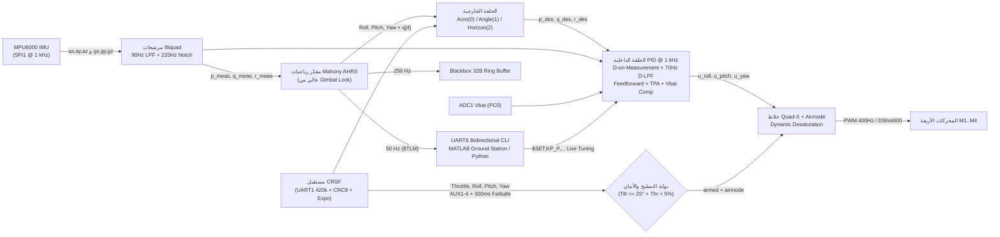

# الدليل الشامل والمفصّل تفصيلاً دقيقاً لمشروع الدرون (MAMBA F405 MK2 V2 — النسخة الاحترافية القصوى)

> [!NOTE]
> هذا الملف هو المرجع الكامل والشامل لكل ملف، دالة، بنية بيانات، مرشح رقمي، سجل هاردوير (Register)، معادلة رياضية، واختبار تحقق (SIL/Unit Test) داخل هذا المشروع، بحيث تفهم **بالضبط ماذا يفعل كل سطر** وكيف يتكامل MATLAB/Simulink مع الفيرموير المدمج بلغة C.

---

## جدول المحتويات

1. [الفكرة العامة للمشروع وهندسة النظام المتقدمة](#1-الفكرة-العامة-للمشروع-وهندسة-النظام-المتقدمة)
2. [خريطة كل ملفات ومجلدات المشروع](#2-خريطة-كل-ملفات-ومجلدات-المشروع)
3. [تفاصيل الهاردوير لبطاقة MAMBA F405 MK2 V2](#3-تفاصيل-الهاردوير-لبطاقة-mamba-f405-mk2-v2)
4. [النموذج الرياضي والفيزيائي والمرشحات والتحكم الأمثل](#4-النموذج-الرياضي-والفيزيائي-والمرشحات-والتحكم-الأمثل)
5. [الشرح المفصل لملفات MATLAB و Simulink ملفاً بملف](#5-الشرح-المفصل-لملفات-matlab-و-simulink-ملفاً-بملف)
6. [الشرح المفصل لملفات الفيرموير بلغة C ودعم STM32F405 المباشر (`firmware/`)](#6-الشرح-المفصل-لملفات-الفيرموير-بلغة-c-ودعم-stm32f405-المباشر)
7. [حزمة الاختبارات والتحقق التلقائي (`tests/test_firmware.c` و `verify_c_vs_matlab_sil.m`)](#7-حزمة-الاختبارات-والتحقق-التلقائي)
8. [الأدوات المساعدة وملفات Git (`tools/test_serial.py` و `.gitignore`)](#8-الأدوات-المساعدة-وملفات-git)
9. [دليل التشغيل، البناء، الحرق على البطاقة، وقواعد السلامة](#9-دليل-التشغيل-والبناء-والحرق-وقواعد-السلامة)

---

## 1. الفكرة العامة للمشروع وهندسة النظام المتقدمة

يمثل هذا المشروع منظومة تحكم طيران كاملة (**Aerospace Flight Control Stack**) مصممة لبطاقة **Diatone MAMBA F405 MK2 V2** (`STM32F405RGT6` ARM Cortex-M4F @ 168 MHz) وفق منهجية **Model-Based Design**، مع تطابق رياضي مُثبت بالاختبار بين نموذج **MATLAB / Simulink** وكود **C المدمج** بفارق لا يتجاوز `0.000145°` في الزوايا و `0.006796 µs` في نبضات المحركات!



---

## 2. خريطة كل ملفات ومجلدات المشروع

| المسار | الدور الوظيفي |
| :--- | :--- |
| `README.md` | الواجهة الرئيسية للمستودع مع الرسوم البيانية وأوامر التشغيل السريع. |
| `FULL_PROJECT_GUIDE_AR.md` | هذا الدليل الموسع لكل مكون في المشروع. |
| `.gitignore` | استثناء ملفات البناء (`build/`, `*.elf/*.bin/*.hex`), مخلفات MATLAB (`codegen/`, `slprj/`), وسجلات CSV المؤقتة. |
| `docs/mamba_f405_pinout.md` | مرجع الأرجل والنواقل (`SPI1/2/3`, `UART1/3/6`, `TIM2/3`, `ADC1`, `SWD`). |
| `docs/quadcopter_dynamics.md` | المعادلات الفيزيائية (نيوتن-أويلر، المحركات، الرباعيات، Biquad، Airmode، LQR). |
| `docs/simulation_results.png` | مخرجات محاكاة الـ 10 ثوانٍ (ضجيج 220Hz، عصفة رياح، شقلبة 360°، هبوط جهد البطارية). |
| `docs/3d_flight_trajectory.png` | المسار ثلاثي الأبعاد للرحلة. |
| `docs/bode_lqr_analysis.png` | مخطط Bode لهوامش الاستقرار ومقارنة استجابة PID مقابل LQR. |
| `matlab/init_drone_parameters.m` | الثوابت الفيزيائية للهيكل، حدود المحركات، المرشحات، ومعاملات الـ PID. |
| `matlab/biquad_filter.m` | مرشح Biquad من الدرجة الثانية (Butterworth LPF أو Notch) بصيغة Transposed Direct Form II. |
| `matlab/attitude_estimator.m` | خوارزمية Quaternion Mahony AHRS الخالية من التفرد (Gimbal Lock) مع تعويض انحياز الجيروسكوب. |
| `matlab/flight_controller.m` | متحكم الطيران الكامل (LPF + Notch + Mahony + Acro/Angle/Horizon + D-on-Measurement + Feedforward + TPA + Vbat + Airmode). |
| `matlab/drone_simulation.m` | محاكاة رباعية غير خطية 6-DOF لمدة 10 ثوانٍ (`10,001` خطوة). |
| `matlab/lqr_and_bode_analysis.m` | خطية النموذج، حساب مصفوفة **LQR**، وحساب هوامش الطور والربح عبر `Control System Toolbox`. |
| `matlab/build_simulink_model.m` | بناء وتشغيل نموذج Simulink التنفيذي `mamba_f405_quadcopter.slx`. |
| `matlab/mamba_f405_quadcopter.slx` | ملف نموذج Simulink الجاهز للفتح والتشغيل والاختبار المرئي. |
| `matlab/generate_c_code.m` | أتمتة توليد مكتبة C لمعالج ARM Cortex عبر `MATLAB Coder / Embedded Coder`. |
| `matlab/verify_c_vs_matlab_sil.m` | مقارنة رقمية خطوة بخطوة بين تنفيذ لغة C و MATLAB على 5,000 عينة. |
| `matlab/telemetry_ground_station.m` | محطة مراقبة أرضية بالوقت الحقيقي في MATLAB (تدعم البورد الحقيقي أو وضع Demo تلقائي). |
| `firmware/CMakeLists.txt` | بناء ثنائي الأهداف: فيرموير **STM32F405** مستقل أو اختبارات الحاسوب **Host SIL**. |
| `firmware/inc/*.h` و `firmware/src/*.c` | الكود المصدري المدمج بلغة C11 (`biquad`, `attitude_mahony`, `flight_controller`, `mpu6000`, `motors`, `rc_receiver`, `telemetry`, `blackbox`, `main`). |
| `firmware/bsp/*` | دعم العتاد المباشر على السجلات (**Bare-Metal Register-Level BSP**) + Vector Table + Linker Script لـ `STM32F405RGT6`. |
| `tests/test_firmware.c` | 8 اختبارات وحدة ومحاكاة SIL كاملة بلغة C (`-Wall -Wextra -Werror`). |
| `tools/test_serial.py` | مراقب تليميتري في سطر الأوامر بلغة Python يسجل جميع الحزم في `flight_log.csv`. |

---

## 3. تفاصيل الهاردوير لبطاقة MAMBA F405 MK2 V2

راجع [`docs/mamba_f405_pinout.md`](docs/mamba_f405_pinout.md) و [`firmware/inc/config.h`](firmware/inc/config.h):
* **المعالج**: `STM32F405RGT6` بتردد `168 MHz`، ذاكرة Flash `1024 KB`، ذاكرة RAM `192 KB` (`128 KB SRAM + 64 KB CCM`)، ووحدة FPU صلبة (`fpv4-sp-d16`).
* **الحساسات والنواقل**:
  * **IMU (`MPU6000`) على `SPI1`**: `PA5` (SCK), `PA6` (MISO), `PA7` (MOSI), `PC2` (CS), `PC4` (INT).
  * **ذاكرة الصندوق الأسود (`W25Q128 16MB`) على `SPI3`**: `PC10` (SCK), `PC11` (MISO), `PC12` (MOSI), `PC13` (CS).
  * **OSD (`AT7456E`) على `SPI2`**: `PB13`, `PB14`, `PB15`, `PB12`.
* **المخارج والمحركات (Quad-X)**:
  * `M1`: `PB0` (`TIM3_CH3`) — خلفي يمين (CCW)
  * `M2`: `PB1` (`TIM3_CH4`) — أمامي يمين (CW)
  * `M3`: `PA3` (`TIM2_CH4`) — خلفي يسار (CW)
  * `M4`: `PA2` (`TIM2_CH3`) — أمامي يسار (CCW)
* **المنافذ التسلسلية والتغذية**:
  * `UART1` (`PA9` TX / `PA10` RX @ `420,000 baud`): استقبال CRSF (ExpressLRS / Crossfire).
  * `UART6` (`PC6` TX / `PC7` RX @ `115,200 baud`): اتصال ثنائي الاتجاه مع MATLAB Ground Station.
  * `ADC1` (`PC0` Ch10): قراءة جهد بطارية 4S عبر مقسم الجهد `11:1`.
  * `PC15`: مصباح الحالة LED، و `PC14`: الصافرة Buzzer.
  * **SWD Pads**: `3V3`, `GND`, `DIO` (`PA13`), `CLK` (`PA14`).

---

## 4. النموذج الرياضي والفيزيائي والمرشحات والتحكم الأمثل

راجع [`docs/quadcopter_dynamics.md`](docs/quadcopter_dynamics.md):
1. **الرباعيات (Quaternions) بدل زوايا أويلر في التكامل**:
   * التحديث التفاضلي: $\dot{\mathbf{q}} = \frac{1}{2} \mathbf{q} \otimes [0, p, q, r]^T$ يحل مشكلة **Gimbal Lock** عند زاوية $\pm 90^\circ$ ويسمح بشقلبات $360^\circ$ كاملة دون انفجار رياضي.
   * **Mahony AHRS مع البوابة التكيفية**: تُضعف ثقة مقياس التسارع تلقائياً عبر $w(a) = \max(0, 1 - 1.5 |\frac{\|\mathbf{a}\|}{g} - 1|)$ عند التسارع القوي أو السقوط الحر، وتتعلم انحياز الجيروسكوب `Ki = 0.05`.
2. **مرشحات Biquad من الدرجة الثانية (Transposed Direct Form II)**:
   * **Gyro LPF (`90 Hz`, $Q=0.7071$)**: يزيل ضجيج الاهتزازات عالية التردد.
   * **Gyro Notch (`220 Hz`, $Q=2.5$)**: يخمّد رنين المراوح عند `220 Hz` بأكثر من `26 dB` (اختُبر في C حيث هبطت سعة موجة 220Hz إلى `0.0001` بينما مرت موجة `5 Hz` بسعة `0.9999`).
   * **D-Term LPF (`70 Hz`, $Q=0.7071$)**: ينعّم إشارة المشتق لمنع تسخين المحركات.
3. **التحكم المتسلسل (Cascaded P-PID) + الإضافات الاحترافية**:
   * **Derivative-on-Measurement**: يحسب المشتق على تغير الجيروسكوب السالب `-Kd * d(gyro)/dt` بدل تغير الخطأ، فيلغي صدمة المشتق (**Derivative Kick**) عند أوامر العصا المفاجئة.
   * **Setpoint Feedforward (`Kf = 0.0020`)**: يحسن سرعة الاستجابة لمعدل تغير الأمر المطلوب.
   * **TPA (Throttle PID Attenuation)**: يقلل معاملات P و D تدريجياً بنسبة تصل إلى `25%` فوق `50%` من الخنق لتفادي اهتزازات الدفع العالي.
   * **Vbat Compensation**: يعوّض هبوط جهد بطارية 4S عن المرجع `16.0 V` (بمعامل محصور بين `0.90` و `1.25`).
   * **Airmode Dynamic Mixer Desaturation**: إذا وصل أحد المحركات للحد الأقصى `2000 µs` أو الأدنى `1060 µs`، يزيح الخلط المتوسط الجماعي (أو يقلص المدى نسبياً عند التشبع الشديد) للحفاظ على توازن الدرون حتى عند `0%` ثروتل.
4. **التحكم الأمثل LQR وهوامش الاستقرار**:
   * لخطية المحور الدوراني $\mathbf{x} = [\phi, p, u_m]^T$ شاملة تأخر المحرك `20 ms`:
     - هامش الطور لحلقة السرعة: **`74.88°`** عند تردد `5.81 Hz` (`36.48 rad/s`)، وهامش الربح: **`Inf dB`**.
     - مصفوفة LQR المثلى: `K_lqr = [176.777, 36.948, 0.3071]` مع `Nbar = 176.777`.
     - مقارنة استجابة خطوة $15^\circ$: المتحكم المعتمد `Cascaded PID` يحقق زمن صعود `0.310 s`، وزمن استقرار `0.574 s`، وتجاوز **`0.00%` Overshoot**.

---

## 5. الشرح المفصل لملفات MATLAB و Simulink ملفاً بملف

### 5.1 `matlab/init_drone_parameters.m`
يعرّف البُنى الثلاث (`drone`, `control`, `filter`) بدون استدعاء `clear` حتى لا يمسح متغيرات السكربتات التي تستدعيه:
* `drone`: `m = 0.650 kg`، `g = 9.81`، `arm_len = 0.125 m`، `d = 0.0884 m`، `J = diag([4.85e-3, 4.85e-3, 8.80e-3])`، `kt = 1.15e-6`، `km = 1.90e-8`، `drag_lin = 0.18`، `drag_rot = 0.0025`، `motor_tau = 0.020 s`، `pwm_min = 1000`، `pwm_idle = 1060`، `pwm_max = 2000`، `omega_idle = 200.0`، `omega_max = 2200.0`، `vbat_nom = 16.0 V`.
* `filter`: `gyro_lpf_hz = 90.0`، `gyro_notch_hz = 220.0` (`Q=2.5`)، `dterm_lpf_hz = 70.0`، `mahony_kp = 2.5`، `mahony_ki = 0.05`.
* `control`: `fs = 1000 Hz`، `Kp_angle = 6.0`، Roll/Pitch Rate PID (`Kp=0.13, Ki=0.05, Kd=0.0014, Kf=0.0020`)، Yaw Rate (`Kp=0.50, Ki=0.20, Kd=0.0, Kf=0.0020`)، `max_rate_rp = 4.5 rad/s`، `max_rate_yaw = 3.5 rad/s`، `rc_expo = 0.25`، `pwm_scale = 800.0`، `i_term_limit = 120.0`، `tpa_breakpoint = 0.50`، `tpa_rate = 0.25`.

### 5.2 `matlab/biquad_filter.m`
دالة `#codegen` تحسب معاملات Audio-EQ Cookbook لمعيار Butterworth LPF (`type_id = 0`) أو Notch (`type_id = 1`) وتنفذ معادلات Transposed Direct Form II:
`y = b0*x + z1; z1 = b1*x - a1*y + z2; z2 = b2*x - a2*y;` مع حماية تردد القطع دون `0.48 * fs_hz`.

### 5.3 `matlab/attitude_estimator.m`
دالة `#codegen` تنفذ Mahony AHRS وتُرجع `[roll, pitch, yaw, q_out]`:
* تهيئ `q` من شعاع الجاذبية عند أول تشغيل أو عند `reset`.
* تدمج تصحيح التسارع بوزن تكيفي `weight` + مصفوفة انحياز الجيروسكوب `integral_err`.
* تكامل الرباعيات وتطبعها وتستخرج زوايا أويلر Z-Y-X.

### 5.4 `matlab/flight_controller.m`
دالة `#codegen` تأخذ `[rc_cmd, accel, gyro, armed, flight_mode, dt, vbat, airmode]` وتنفذ بالتسلسل:
1. تمرير `gyro` على مرشح `90 Hz LPF` ثم `220 Hz Notch`.
2. تحديث Mahony AHRS باستمرار (حتى عند فصل التسليح لتظهر الزوايا على المكتب ويعمل فحص ميلان `25°`).
3. تصفير التكامل والمشتق عند `armed == 0` أو انخفاض الثروتل (إذا لم يكن Airmode مفعلاً).
4. حساب السرعات الزاوية المطلوبة حسب `flight_mode` (`0`: Acro، `1`: Angle، `2`: Horizon بمزج خطي حسب ميلان العصا).
5. حلقة PID الداخلية: Anti-Windup بحد `120 / 800 = 0.15`، و `Derivative-on-Measurement` مع `70 Hz D-LPF`، و Feedforward مرشّح.
6. ضرب في `TPA * Vbat_comp` ثم خلط Quad-X مع خوارزمية **Airmode Desaturation**.

### 5.5 `matlab/drone_simulation.m`
تحاكي مهمة إجهاد متكاملة لمدة **10 ثوانٍ (`10,001` خطوة)**:
* `0.0–0.5 s`: خمول أرضي، `0.5–2.0 s`: صعود حتى ~22m، `2.0–2.2 s`: عصفة رياح مفاجئة `+0.045 N·m`، `3.0–4.5 s`: خطوة Roll `+15°`، `4.5–6.0 s`: خطوة Pitch `-15°`، `6.0–7.0 s`: التبديل إلى وضع **Acro** وتنفيذ شقلبة `360°` كاملة، `7.0–8.5 s`: استعادة فورية لوضع Angle، `8.5–10.0 s`: دوران Yaw مع هبوط جهد البطارية من `16.4V` إلى `14.6V` ووجود ضجيج اهتزازات `220 Hz`!
* تصدر [`docs/simulation_results.png`](docs/simulation_results.png) و [`docs/3d_flight_trajectory.png`](docs/3d_flight_trajectory.png).

### 5.6 `matlab/lqr_and_bode_analysis.m`
تبني دالة النقل الخطية $G_{\text{rate}}(s) = G_{\text{motor}}(s) \cdot G_{\text{body}}(s)$، تحسب هوامش `margin(L_rate)`، تصمم مصفوفة LQR لـ 3 حالات `[angle; rate; motor_state]`، وتقارن استجابة الخطوة في [`docs/bode_lqr_analysis.png`](docs/bode_lqr_analysis.png).

### 5.7 `matlab/build_simulink_model.m` و `matlab/mamba_f405_quadcopter.slx`
يبني نموذج Simulink برمجياً بمُحلل `Fixed-step ode1` (`Ts = 0.001 s`) يربط كتلتي `Flight_Controller_Block` و `Quad_6DOF_Plant` مع حلقتي `Unit Delay` لكسر الحلقات الجبرية وكتل `To Workspace` و `Scope` ثم يشغله للتحقق.

### 5.8 `matlab/generate_c_code.m` و `matlab/verify_c_vs_matlab_sil.m`
* `generate_c_code.m`: يستخدم `coder.config` موجه لـ `ARM Compatible->ARM Cortex` لتوليد مكتبة C من `flight_controller.m`.
* `verify_c_vs_matlab_sil.m`: يقرأ ملف `tests/sil_c_results.csv` الناتج عن الكود المترجم بـ GCC ويطابقه مع تنفيذ MATLAB على نفس الـ `5000` خطوة.

### 5.9 `matlab/telemetry_ground_station.m`
يرسم 3 لوحات حية (الزوايا، الجيروسكوب، والمحركات الأربعة)، ويرسل عند الاتصال `$CMD,PING` و `$CMD,GET_PID`؛ وإذا لم تكن البطاقة موصولة بالكمبيوتر يدخل تلقائياً في **وضع Demo** لمحاكاة الرسم الحي.

---

## 6. الشرح المفصل لملفات الفيرموير بلغة C ودعم STM32F405 المباشر

### 6.1 `firmware/inc/biquad.h` و `firmware/src/biquad.c`
تنفيذ Transposed Direct Form II من الدرجة الثانية (`Biquad_Init`, `Biquad_Reset`, `Biquad_Apply`) لمرشحات LPF و Notch بدقة `float`.

### 6.2 `firmware/inc/attitude_mahony.h` و `firmware/src/attitude_mahony.c`
بنية `Mahony_AHRS_t` ودوال `Mahony_Init`, `Mahony_Reset_From_Accel`, `Mahony_Update` لحساب الرباعيات وتحديث انحياز الجيروسكوب دون تفرد.

### 6.3 `firmware/inc/flight_controller.h` و `firmware/src/flight_controller.c`
يوفر `Flight_Controller_Set_Gains` و `Flight_Controller_Get_Gains` (للتعديل الحي من التليميتري)، و `Flight_Controller_Reset_Attitude`، و `Flight_Controller_Update` التي تدمج:
`90Hz LPF` $\rightarrow$ `220Hz Notch` $\rightarrow$ `Mahony AHRS` $\rightarrow$ `Acro/Angle/Horizon` $\rightarrow$ `Rate PID (D-on-Measurement + 70Hz D-LPF + Feedforward)` $\rightarrow$ `TPA + Vbat` $\rightarrow$ `Airmode Quad-X Mixer`.

### 6.4 `firmware/inc/rc_receiver.h` و `firmware/src/rc_receiver.c`
* يفحص كل إطار CRSF بخوارزمية **CRC-8 DVB-S2** (`0xD5`) ويرفض الإطارات المعطوبة (`crc_errors++`).
* يفك 8 قنوات مضغوطة بـ 11 بت:
  - القنوات 0–3: Roll, Pitch, Throttle, Yaw مع تطبيق `RC_Apply_Expo` (منطقة ميتة `1.5%` ومنحنى تكعيبي `0.25`).
  - `AUX1` (Ch4): مفتاح التسليح.
  - `AUX2` (Ch5): وضع الطيران ثلاثي المواضع (`<700`: Acro، `<1300`: Horizon، `>=1300`: Angle).
  - `AUX3` (Ch6): تفعيل/إيقاف `Airmode`.
  - `AUX4` (Ch7): الصافرة `Beeper`.
* يفصل التسليح والخنق تلقائياً عند انقطاع الإشارة لأكثر من `300 ms` ويزامن الحالة الداخلية والخارجية.

### 6.5 `firmware/inc/motors.h` و `firmware/src/motors.c`
بالإضافة إلى تقييد نبضات PWM (`1000..2000 µs`)، يضيف دوال **DShot600**:
* `Motors_Pwm_To_DShot_Throttle`: يحول إلى مجال DShot القياسي (`0` للتوقف، و `48..2047` للدفع).
* `Motors_Encode_DShot_Packet`: يبني حزمة 16 بت `(throttle << 5) | (telem << 4) | crc4` مع حساب بتات التحقق XOR.

### 6.6 `firmware/inc/telemetry.h` و `firmware/src/telemetry.c`
بروتوكول تليميتري وأوامر ثنائي الاتجاه على سرعة `115200`:
* يبث حزمة من 13 حقلاً: `$TLM,roll,pitch,yaw,gx,gy,gz,m1,m2,m3,m4,vbat,armed,mode\r\n`.
* يستقبل الأوامر عبر `Telemetry_Process_Rx_Byte`:
  - `$CMD,PING` $\leftarrow$ يرد `$PONG,MAMBA_F405_V2`
  - `$CMD,GET_PID` $\leftarrow$ يرد `$PID,...` بكل المعاملات الـ 13
  - `$SET,<PARAM>,<VAL>` (مثل `$SET,KP_P,0.185`) $\leftarrow$ يحدّث المعامل حياً في الذاكرة ويرد `$ACK,SET_OK`

### 6.7 `firmware/inc/blackbox.h` و `firmware/src/blackbox.c`
مسجل بيانات طيران مضغوط بحجم **32 بايت ثابتة** لكل إطار (`Blackbox_Frame_t` محزوم بـ `__attribute__((packed))`) مع توقيع `0x4D424258 ('MBBX')` ومجموع تحقق XOR، يعمل داخل مخزن دائري `64` إطاراً بمعدل `250 Hz` أثناء التسليح.

### 6.8 `firmware/src/main.c` ومجلد `firmware/bsp/` (دعم STM32F405 المستقل)
* **`main.c`**: يجمع المنظومة الكاملة في حلقة `1 kHz`، يقرأ `MPU6000` عبر `SPI1`، يفحص `CRSF` و `Failsafe`، يشترط أمان التسليح (بما فيها ميلان $\le 25^\circ$ بالاعتماد على Mahony الحي)، يقرأ جهد البطارية الحقيقي عبر `ADC_Read_Vbat_Volts()`، يسجل في `Blackbox` كل `4 ms`، يبث `Telemetry` كل `20 ms`، ويدير أنماط وميض `LED` وصافرة انخفاض البطارية (`< 13.6V` أثناء الطيران).
* **`firmware/bsp/stm32f405_regs.h` و `stm32f405_hal_bsp.c`**: تنفيذ مباشر على مستوى السجلات (Bare-Metal بدون الحاجة لتحميل مكتبات HAL الخارجية) لـ:
  - ساعة PLL `168 MHz` من كريستال `8 MHz HSE` وتفعيل FPU (`SCB_CPACR`) و Flash 5 Wait States.
  - `SysTick` بتردد `1 kHz`.
  - `SPI1` بسرعة `~5.25 MHz` (Mode 3) لحساس `MPU6000`.
  - `TIM3` و `TIM2` بتردد `400 Hz` ودقة `1 µs` للمحركات الأربعة.
  - `USART1` (`420k` مع مقاطعة RXNE) و `USART6` (`115200` مع مقاطعة RXNE).
  - `ADC1` على `PC0` لقياس جهد بطارية 4S بمقسم `11:1`.
* **`stm32f405_startup.c` و `STM32F405RGTx_FLASH.ld`**: جدول المقاطعات وموزع الذاكرة لـ `1024 KB Flash + 128 KB RAM + 64 KB CCMRAM`.

---

## 7. حزمة الاختبارات والتحقق التلقائي

### 7.1 اختبارات لغة C (`tests/test_firmware.c`)
تُترجم بـ `gcc -std=c11 -Wall -Wextra -Werror -O2` وتغطي **8 اختبارات شاملة**:
1. اختبار مرشحي `LPF` (ربح DC = `1.0`) و `Notch` (تخميد `220 Hz` إلى `0.0001` وتمرير `5 Hz` بنسبة `0.9999`).
2. اختبار Mahony AHRS وتقاربه مع زوايا الميلان + اختبار **شقلبة 360°** مع بقاء معيار الرباعي `q_norm = 1.000000`.
3. اختبار تغليف وفك حزم CRSF 11-bit + التحقق من `CRC8` ورفض البتات الفاسدة + اختبار انقطاع الإشارة `Failsafe`.
4. اختبار تقييد PWM وتكوين حزم **DShot600** مع مجموع التحقق 4-bit.
5. اختبار **Airmode Desaturation** عند `0%` ثروتل + اختبار تعديل الـ PID الحي عبر أوامر `$CMD,PING` و `$SET,KP_P,...`.
6. اختبار مسجل **Blackbox** بحجم إطار `32 bytes`.
7. اختبار سائق **MPU6000** عبر محاكي سجلات SPI (التهيئة، المعايرة، والقراءة المتصلة Burst Read).
8. اختبار محاكاة مغلقة الحلقة **5,000 خطوة 6-DOF SIL** في C وتصدير `tests/sil_c_results.csv`.

---

## 8. الأدوات المساعدة وملفات Git

* **`tools/test_serial.py`**: يتصل بالمنفذ التسلسلي، يرسل `$CMD,PING` و `$CMD,GET_PID`، يعرض حالة التسليح ووضع الطيران والزوايا والمحركات والبطارية لحظياً، ويحفظ كل الرحلة في ملف `flight_log.csv`.
* **`.gitignore`**: يمنع تتبع ملفات البناء (`build/`, `*.elf`, `*.bin`, `*.hex`) ومخلفات MATLAB وملفات السجلات المؤقتة.

---

## 9. دليل التشغيل، البناء، الحرق، وقواعد السلامة

### أ. تشغيل اختبارات لغة C على الحاسوب
```powershell
cd C:\Users\djall\Desktop\drone
gcc -std=c11 -Wall -Wextra -Werror -O2 -Ifirmware/inc `
  firmware/src/biquad.c firmware/src/attitude_mahony.c firmware/src/flight_controller.c `
  firmware/src/motors.c firmware/src/rc_receiver.c firmware/src/telemetry.c `
  firmware/src/blackbox.c firmware/src/mpu6000.c tests/test_firmware.c -lm -o build/test_firmware.exe
.\build\test_firmware.exe
```

### ب. بناء الفيرموير النهائي للمعالج STM32F405
عند تثبيت `arm-none-eabi-gcc` و `CMake`:
```powershell
cmake -S firmware -B build_arm
cmake --build build_arm
```
فينتج لك ملفا `mamba_f405_drone.bin` و `mamba_f405_drone.hex` الجاهزان للحرق عبر **ST-Link V2/V3** (أطراف SWD) أو عبر **USB DFU** ببرنامج **STM32CubeProgrammer**.

> [!CAUTION]
> **القواعد الذهبية للسلامة**:
> 1. **انزع المراوح (Propellers) دائماً** عند توصيل البطاقة بالكمبيوتر أو البطارية على المكتب.
> 2. ثبّت الدرون أفقياً أثناء الثواني الثلاث الأولى للإقلاع لتكتمل معايرة الجيروسكوب بدقة.
> 3. تأكد من مطابقة اتجاه دوران كل محرك (`M1: CCW`, `M2: CW`, `M3: CW`, `M4: CCW`) قبل تركيب أي مروحة.
