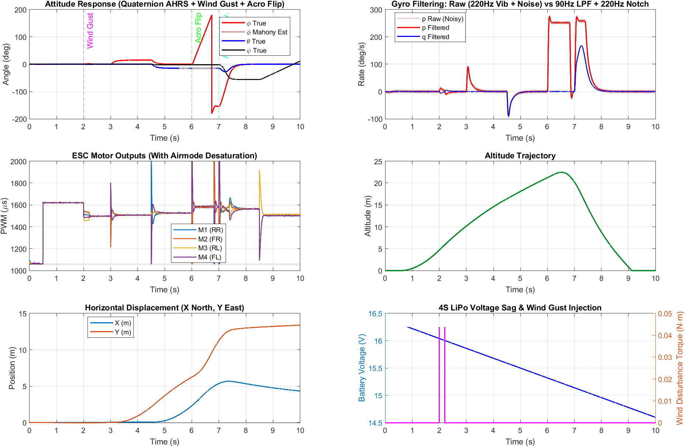
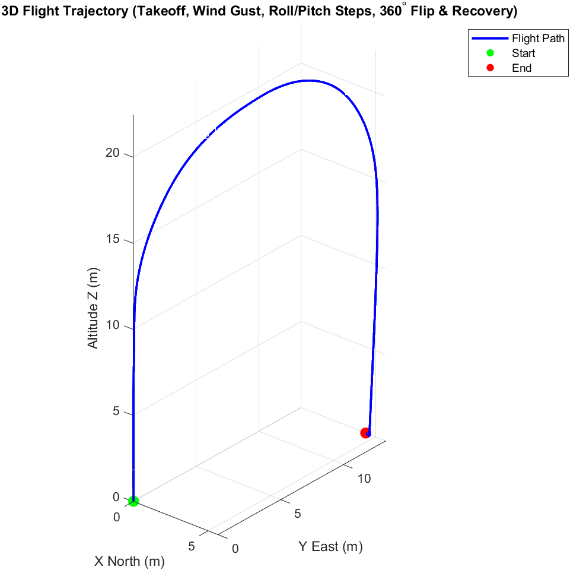
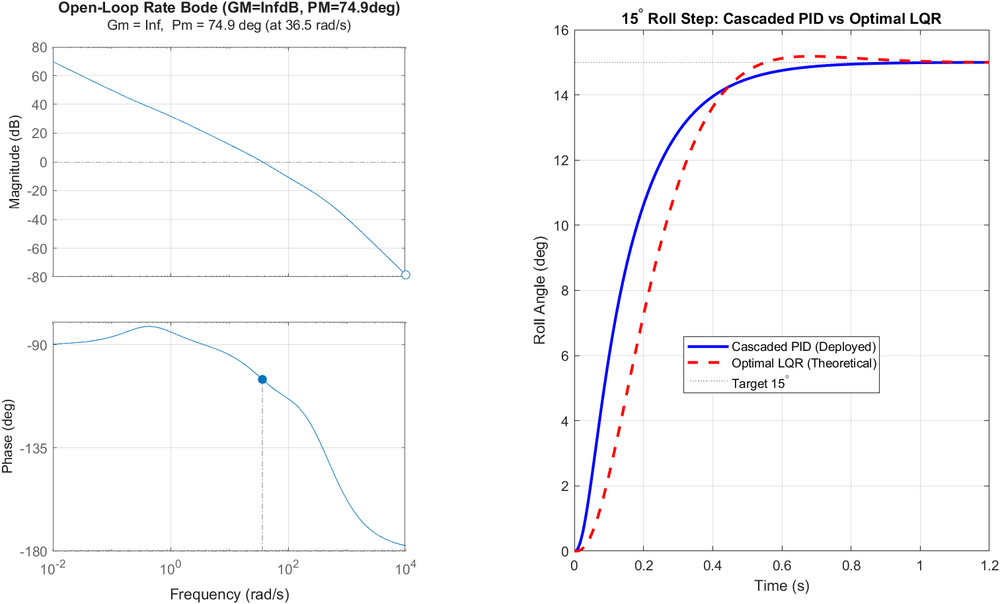

# MAMBA F405 MK2 V2 — Aerospace Flight Control Stack (MATLAB / Simulink + Bare-Metal Embedded C)

A production-grade Model-Based Design flight control system for a **Quad-X** quadcopter powered by the **Diatone MAMBA F405 MK2 V2** (`STM32F405RGT6` ARM Cortex-M4F @ 168 MHz, `MPU6000` SPI IMU).

---

## ✨ Key Capabilities

* **Digital Signal Conditioning**: 2nd-order Butterworth Gyro LPF (`90 Hz`), 2nd-order Gyro Notch Filter (`220 Hz`, $Q=2.5$), and 2nd-order Butterworth D-Term LPF (`70 Hz`) using Transposed Direct Form II biquads.
* **Singularity-Free Attitude Estimation**: Quaternion **Mahony AHRS** with adaptive accelerometer confidence gating and online gyro-bias learning (immune to $\pm 90^\circ$ gimbal lock during $360^\circ$ flips).
* **Advanced Cascaded Flight Control (`1 kHz`)**:
  * **3 Flight Modes**: `ACRO` (`0`), `ANGLE` (`1`), and `HORIZON` (`2`) with RC Expo & center deadband.
  * **Derivative-on-Measurement** (zero derivative kick) + **Filtered Setpoint Feedforward**.
  * **Airmode Dynamic Mixer Desaturation** (preserves roll/pitch/yaw authority at `0%` and `100%` throttle).
  * **TPA** (Throttle PID Attenuation above `50%` throttle) & **4S LiPo Voltage Sag Compensation** (`16.0 V` nominal).
* **Full Bare-Metal STM32F405 BSP (`firmware/bsp/`)**: Register-level `168 MHz` PLL clock, `SysTick` `1 kHz`, `SPI1` IMU driver, `TIM2/TIM3` `400 Hz` PWM + **DShot600** packet encoder, `USART1` **CRSF with CRC8 (`0xD5`)** + `300 ms` failsafe, `USART6` **Bidirectional Telemetry CLI** (live `$SET` PID tuning), `ADC1` battery voltage sensing, and `32-byte` packed **Blackbox Ring Buffer**.
* **MATLAB / Simulink Control Suite (`matlab/`)**:
  * Nonlinear **6-DOF Quaternion Flight Simulator** with `220 Hz` vibration, wind-gust rejection, battery sag, and `360°` flip verification.
  * **Linear State-Space, Optimal LQR Synthesis & Bode Stability Margins** (`Control System Toolbox`).
  * Runnable **Simulink Model** (`mamba_f405_quadcopter.slx`) & **Embedded Coder** C generation (`generate_c_code.m`).
  * **Real-Time Ground Station & Live Demo** (`telemetry_ground_station.m`) + Python CSV logger (`tools/test_serial.py`).
* **Software-in-the-Loop (SIL) Verified**: Native GCC C unit test suite (`tests/test_firmware.c`) + MATLAB-vs-C equivalence check (`verify_c_vs_matlab_sil.m`).

---

## 📂 Project Structure

```
C:\Users\djall\Desktop\drone\
├── FULL_PROJECT_GUIDE_AR.md          # الدليل العربي الشامل والمفصل لكل ملف وسطر ودالة
├── README.md                         # Project overview & quick start
├── .gitignore
├── docs/
│   ├── mamba_f405_pinout.md          # Complete STM32F405 pinout, SPI/UART/Timer/ADC map
│   ├── quadcopter_dynamics.md        # 6-DOF math, quaternion AHRS, mixer, LQR & biquad theory
│   ├── simulation_results.png        # 6-panel 10s stress simulation output
│   ├── 3d_flight_trajectory.png      # 3D simulated flight path
│   └── bode_lqr_analysis.png         # Bode stability margins & PID vs LQR step response
├── matlab/
│   ├── init_drone_parameters.m       # Airframe, filter, and PID constants
│   ├── biquad_filter.m               # 2nd-order LPF / Notch filter (#codegen)
│   ├── attitude_estimator.m          # Quaternion Mahony AHRS (#codegen)
│   ├── flight_controller.m           # Full 1 kHz controller (#codegen)
│   ├── drone_simulation.m            # 10s 6-DOF quaternion stress simulator
│   ├── lqr_and_bode_analysis.m       # Linearization, LQR synthesis, Bode & step margins
│   ├── build_simulink_model.m        # Builds & simulates mamba_f405_quadcopter.slx
│   ├── mamba_f405_quadcopter.slx     # Executable Simulink closed-loop model
│   ├── generate_c_code.m             # Embedded Coder ARM Cortex C generator
│   ├── verify_c_vs_matlab_sil.m      # C-vs-MATLAB 5000-step equivalence verifier
│   └── telemetry_ground_station.m    # Live MATLAB oscilloscope (hardware or demo mode)
├── firmware/
│   ├── CMakeLists.txt                # Dual-target CMake (STM32F405 bare-metal / Host SIL tests)
│   ├── inc/                          # config.h, biquad.h, attitude_mahony.h, flight_controller.h,
│   │                                 # mpu6000.h, motors.h, rc_receiver.h, telemetry.h, blackbox.h
│   ├── src/                          # Modular C11 flight controller & drivers
│   └── bsp/                          # Bare-metal STM32F405RGT6 startup, linker script & BSP
├── tests/
│   └── test_firmware.c               # 8-suite C unit & 6-DOF SIL test harness
└── tools/
    └── test_serial.py                # Python telemetry monitor & CSV flight logger
```

---

## 📊 Simulation & Control Verification Results

### 1. 10-Second 6-DOF Stress Simulation (220 Hz Vibration + Wind Gust + 360° Acro Flip)


### 2. 3D Flight Path


### 3. Bode Stability Margins & PID vs Optimal LQR
* **Open-Loop Rate Margin**: Gain Margin = `Inf dB`, Phase Margin = `74.88°` at `5.81 Hz` (`36.48 rad/s`).
* **15° Roll Step**: Cascaded PID achieves `0.310 s` rise time, `0.574 s` settling time, and **`0.00%` overshoot**.
* **Simulink Closed-Loop Model (`mamba_f405_quadcopter.slx`)**: `6.0 s` run settles cleanly at **`Roll = 15.00°`**, **`Pitch = -15.00°`**; Embedded Coder `ARM Cortex` C code generation verified.
* **C vs MATLAB SIL Equivalence (5,000 steps @ 1 kHz)**: Max Roll difference = **`0.000145°`**, Max Motor PWM difference = **`0.006796 µs`** (all 8 C test suites pass with `-Wall -Wextra -Werror`).



---

## 🚀 Quick Start

### Run MATLAB Simulations & Analysis
```matlab
cd('C:\Users\djall\Desktop\drone\matlab');
drone_simulation          % 6-DOF quaternion flight stress simulation
lqr_and_bode_analysis     % State-space LQR & Bode stability margins
```

### Run C Firmware Unit & SIL Tests (MinGW / GCC)
```powershell
cd C:\Users\djall\Desktop\drone
gcc -std=c11 -Wall -Wextra -Werror -O2 -Ifirmware/inc `
  firmware/src/biquad.c firmware/src/attitude_mahony.c firmware/src/flight_controller.c `
  firmware/src/motors.c firmware/src/rc_receiver.c firmware/src/telemetry.c `
  firmware/src/blackbox.c firmware/src/mpu6000.c tests/test_firmware.c -lm -o build/test_firmware.exe
.\build\test_firmware.exe
```

### Build Bare-Metal STM32F405 Binary (`arm-none-eabi-gcc`)
```powershell
cmake -S firmware -B build_arm -G "Ninja"
cmake --build build_arm
```
Flash `build_arm/mamba_f405_drone.bin` or `.hex` via **ST-Link SWD** (`3V3, GND, DIO, CLK`) or **USB DFU** (`STM32CubeProgrammer`).

---

> [!CAUTION]
> **Bench Safety Rule**: ALWAYS remove all 4 propeller blades before connecting USB, ST-Link, or a LiPo battery on the workbench!
